# Colorlib Blogger Templates

Twenty free Blogger / Blogspot themes for recipes, travel, magazines, learning, portfolios and more. Each theme has its own layout, sample content and editable article format.

[Browse live previews](https://puikinsh.github.io/Colorlib-Blogger-Templates/lab/) · [Installation guide](#install-a-template) · [Release downloads](https://github.com/puikinsh/Colorlib-Blogger-Templates/releases/tag/v0.1.0-preview.5)

## Choose your template

Click a screenshot or **Details & download** to open that template's guide. Every guide names the exact ZIP and XML files to use.

<table>
<tbody>
<tr><td width="50%"><a href="themes/saffron/README.md">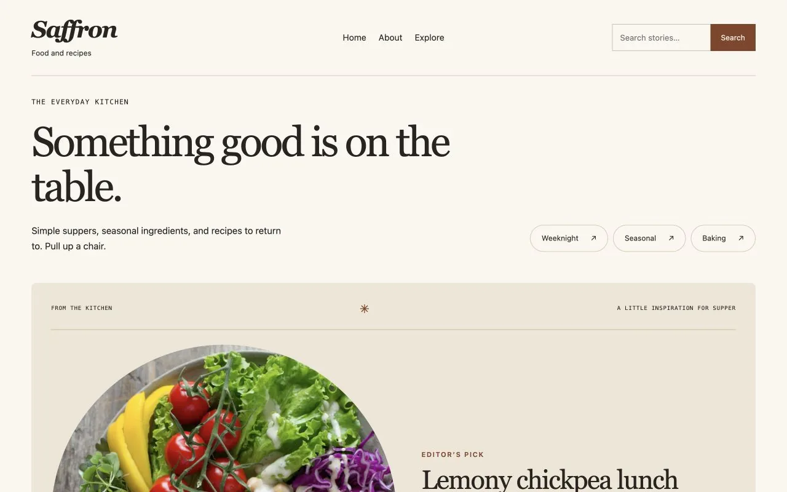</a> <strong>Saffron</strong> Food and recipes <a href="themes/saffron/README.md#download">Details &amp; download</a> · <a href="https://puikinsh.github.io/Colorlib-Blogger-Templates/saffron/">Live preview</a></td><td width="50%"><a href="themes/wayfarer/README.md">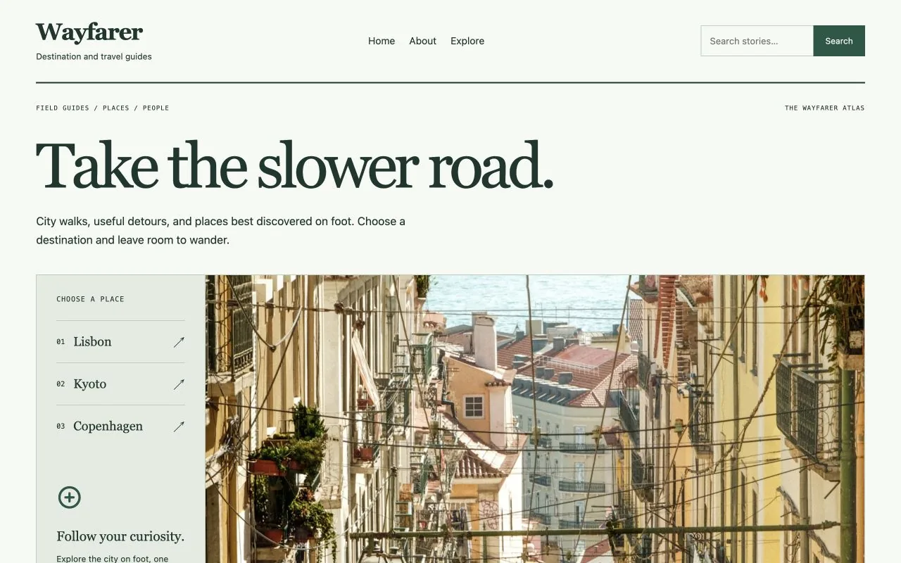</a> <strong>Wayfarer</strong> Destination and travel guides <a href="themes/wayfarer/README.md#download">Details &amp; download</a> · <a href="https://puikinsh.github.io/Colorlib-Blogger-Templates/wayfarer/">Live preview</a></td></tr>
<tr><td width="50%"><a href="themes/lesson/README.md">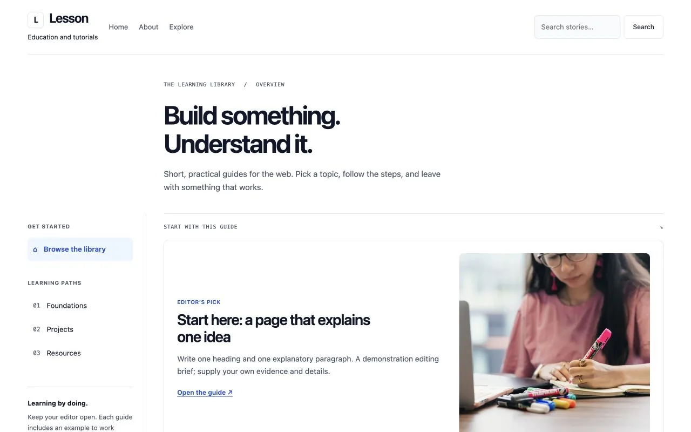</a> <strong>Lesson</strong> Education and tutorials <a href="themes/lesson/README.md#download">Details &amp; download</a> · <a href="https://puikinsh.github.io/Colorlib-Blogger-Templates/lesson/">Live preview</a></td><td width="50%"><a href="themes/bench/README.md">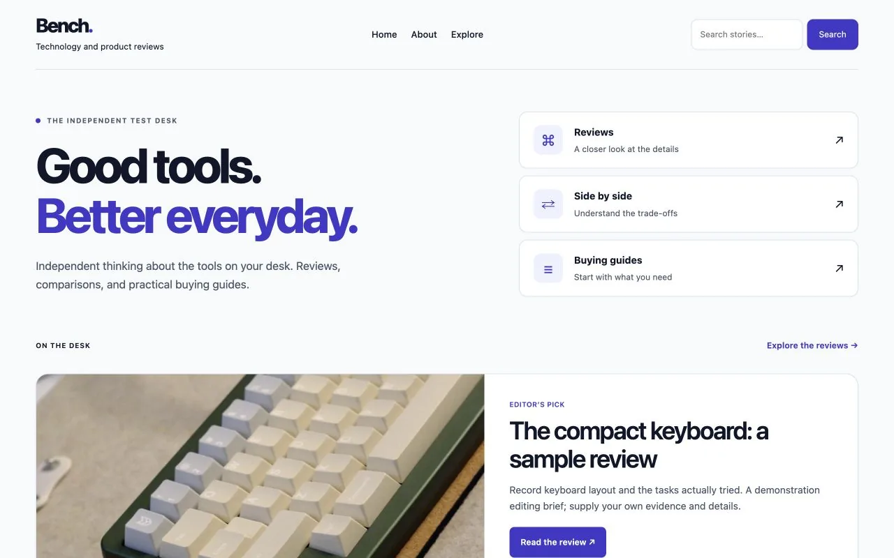</a> <strong>Bench</strong> Technology and product reviews <a href="themes/bench/README.md#download">Details &amp; download</a> · <a href="https://puikinsh.github.io/Colorlib-Blogger-Templates/bench/">Live preview</a></td></tr>
<tr><td width="50%"><a href="themes/maker/README.md">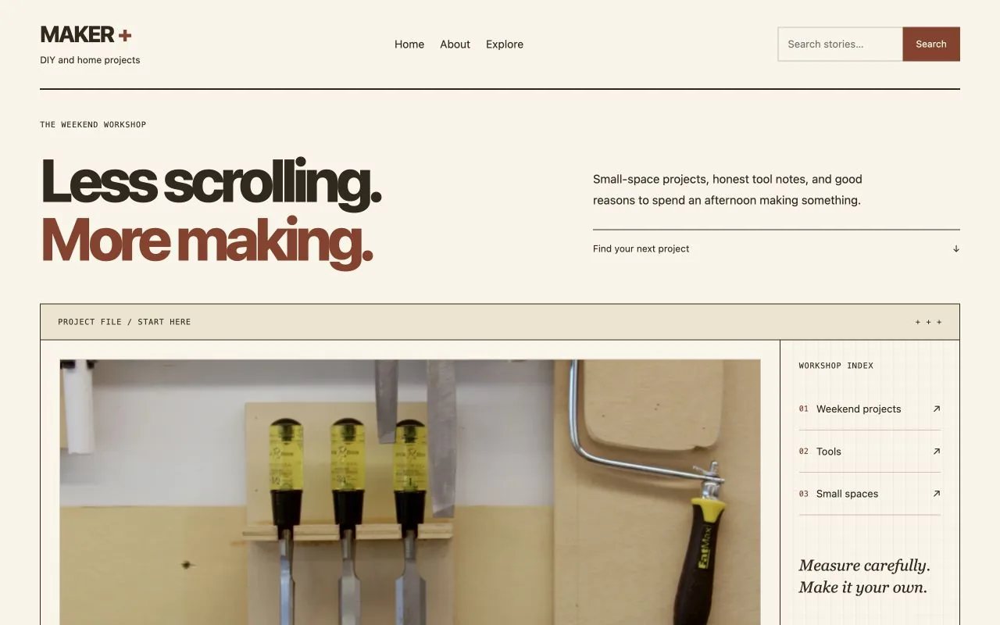</a> <strong>Maker</strong> DIY and home projects <a href="themes/maker/README.md#download">Details &amp; download</a> · <a href="https://puikinsh.github.io/Colorlib-Blogger-Templates/maker/">Live preview</a></td><td width="50%"><a href="themes/muse/README.md">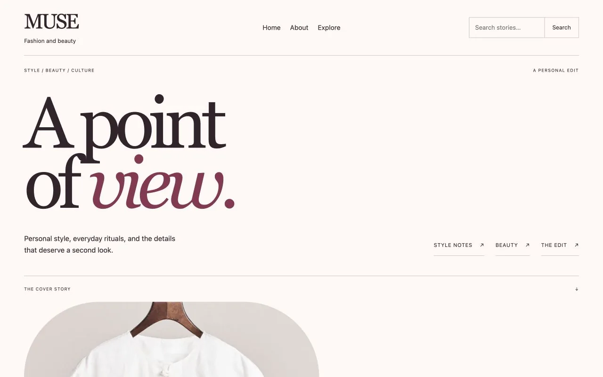</a> <strong>Muse</strong> Fashion and beauty <a href="themes/muse/README.md#download">Details &amp; download</a> · <a href="https://puikinsh.github.io/Colorlib-Blogger-Templates/muse/">Live preview</a></td></tr>
<tr><td width="50%"><a href="themes/kinship/README.md">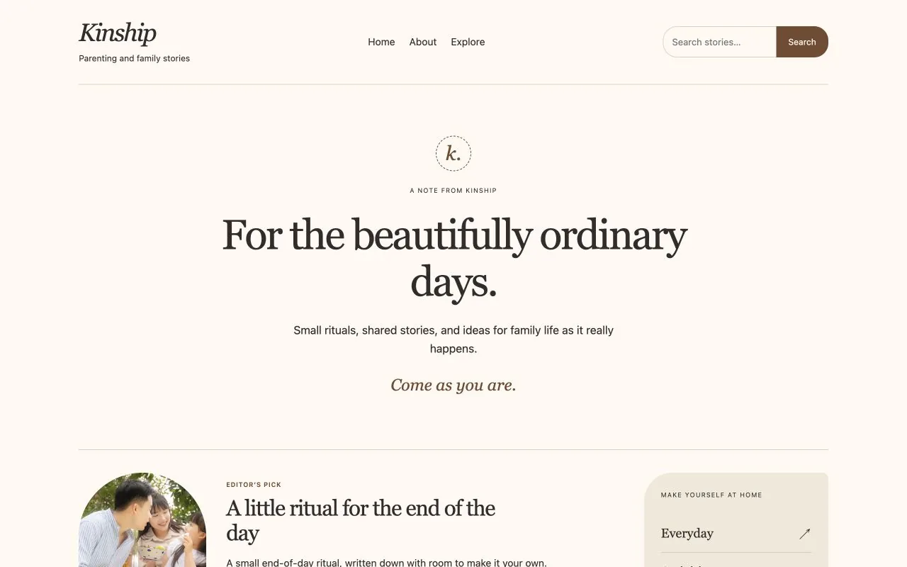</a> <strong>Kinship</strong> Parenting and family stories <a href="themes/kinship/README.md#download">Details &amp; download</a> · <a href="https://puikinsh.github.io/Colorlib-Blogger-Templates/kinship/">Live preview</a></td><td width="50%"><a href="themes/companion/README.md">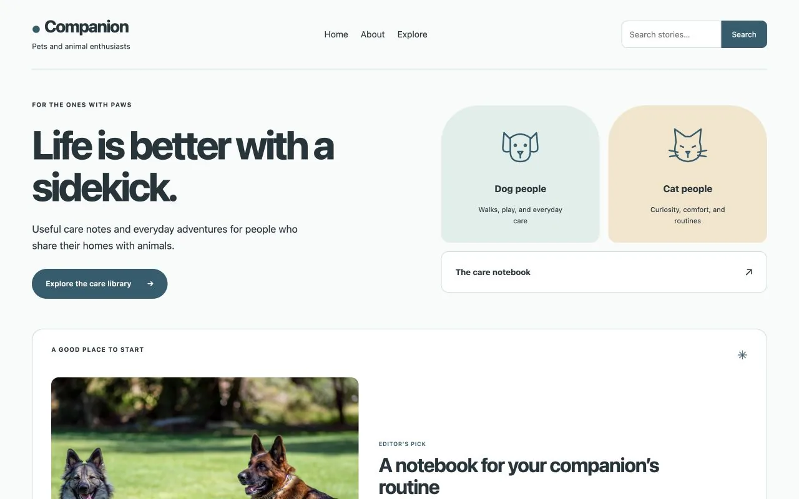</a> <strong>Companion</strong> Pets and animal enthusiasts <a href="themes/companion/README.md#download">Details &amp; download</a> · <a href="https://puikinsh.github.io/Colorlib-Blogger-Templates/companion/">Live preview</a></td></tr>
<tr><td width="50%"><a href="themes/shelf/README.md">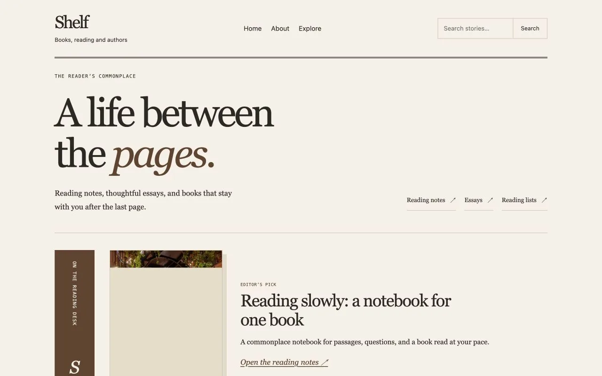</a> <strong>Shelf</strong> Books, reading and authors <a href="themes/shelf/README.md#download">Details &amp; download</a> · <a href="https://puikinsh.github.io/Colorlib-Blogger-Templates/shelf/">Live preview</a></td><td width="50%"><a href="themes/playbook/README.md">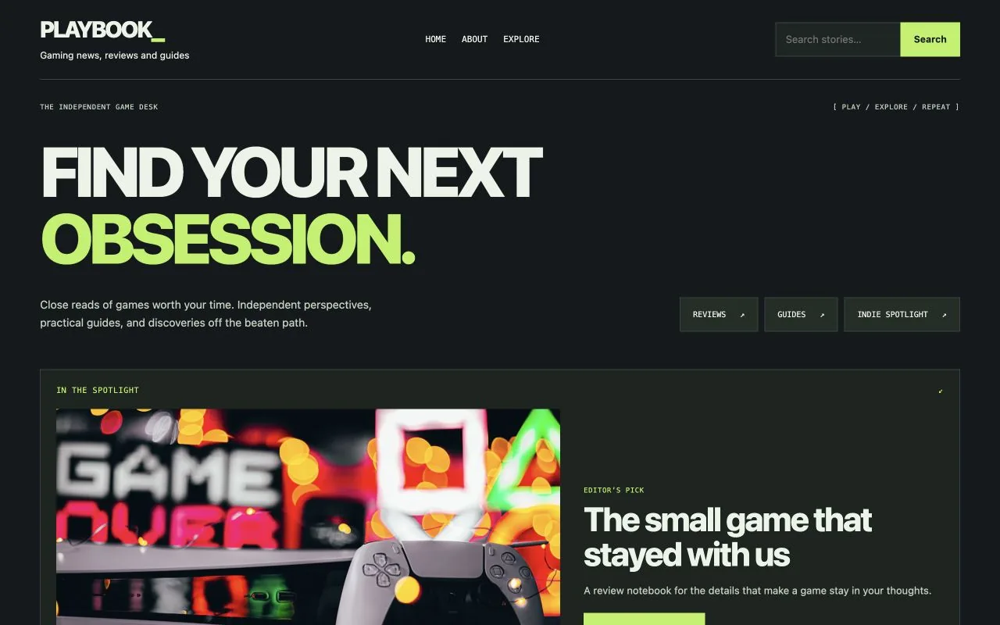</a> <strong>Playbook</strong> Gaming news, reviews and guides <a href="themes/playbook/README.md#download">Details &amp; download</a> · <a href="https://puikinsh.github.io/Colorlib-Blogger-Templates/playbook/">Live preview</a></td></tr>
<tr><td width="50%"><a href="themes/soundboard/README.md">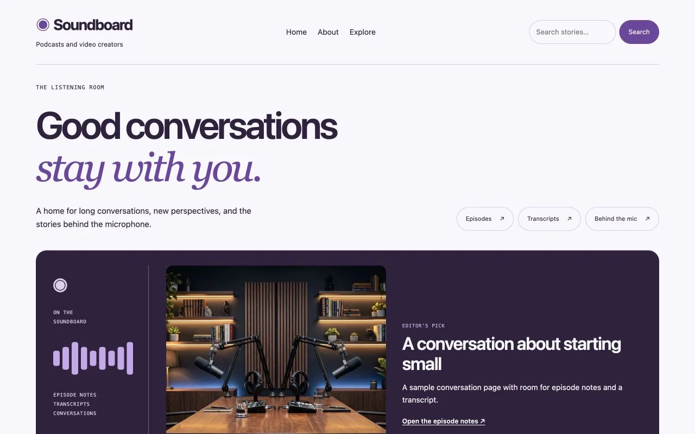</a> <strong>Soundboard</strong> Podcasts and video creators <a href="themes/soundboard/README.md#download">Details &amp; download</a> · <a href="https://puikinsh.github.io/Colorlib-Blogger-Templates/soundboard/">Live preview</a></td><td width="50%"><a href="themes/verdant/README.md">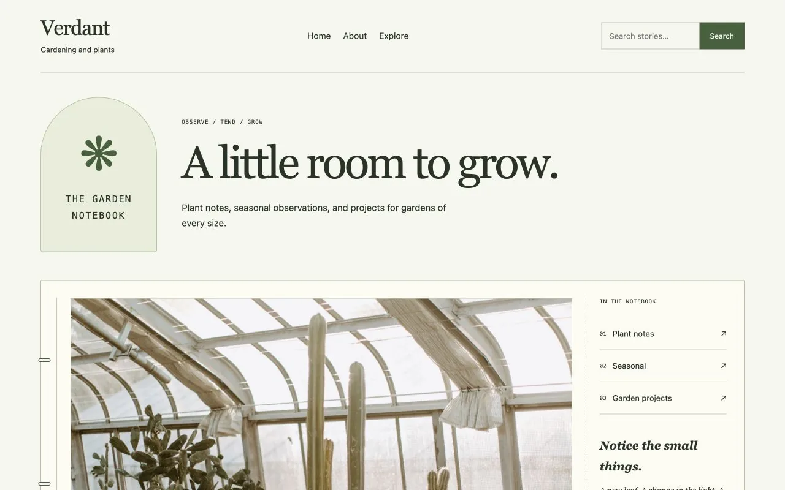</a> <strong>Verdant</strong> Gardening and plants <a href="themes/verdant/README.md#download">Details &amp; download</a> · <a href="https://puikinsh.github.io/Colorlib-Blogger-Templates/verdant/">Live preview</a></td></tr>
<tr><td width="50%"><a href="themes/pace/README.md">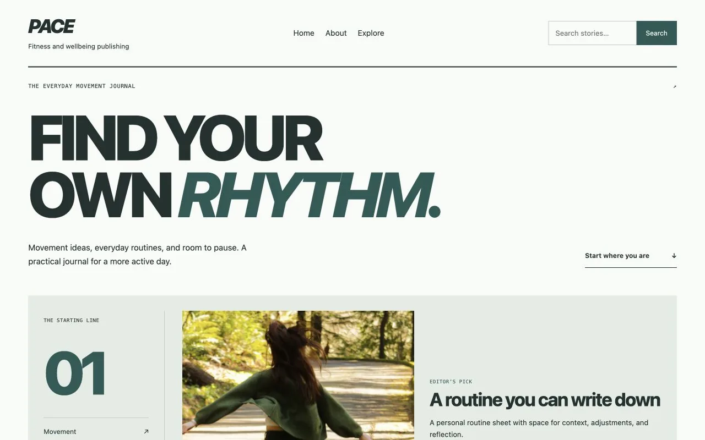</a> <strong>Pace</strong> Fitness and wellbeing publishing <a href="themes/pace/README.md#download">Details &amp; download</a> · <a href="https://puikinsh.github.io/Colorlib-Blogger-Templates/pace/">Live preview</a></td><td width="50%"><a href="themes/ledger/README.md">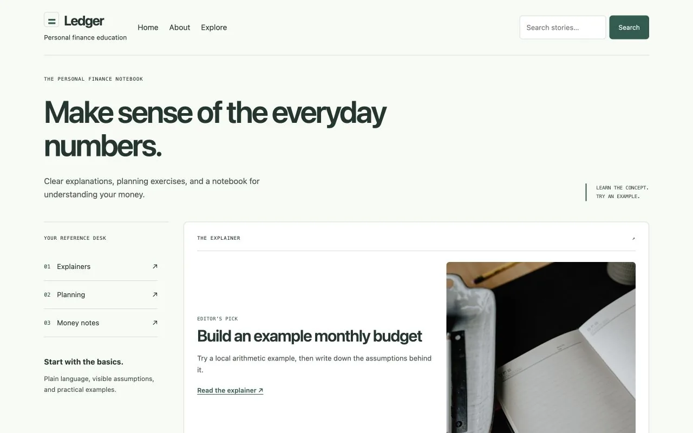</a> <strong>Ledger</strong> Personal finance education <a href="themes/ledger/README.md#download">Details &amp; download</a> · <a href="https://puikinsh.github.io/Colorlib-Blogger-Templates/ledger/">Live preview</a></td></tr>
<tr><td width="50%"><a href="themes/screen/README.md">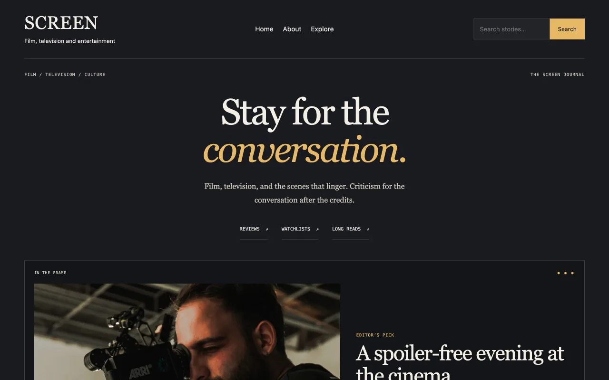</a> <strong>Screen</strong> Film, television and entertainment <a href="themes/screen/README.md#download">Details &amp; download</a> · <a href="https://puikinsh.github.io/Colorlib-Blogger-Templates/screen/">Live preview</a></td><td width="50%"><a href="themes/borough/README.md">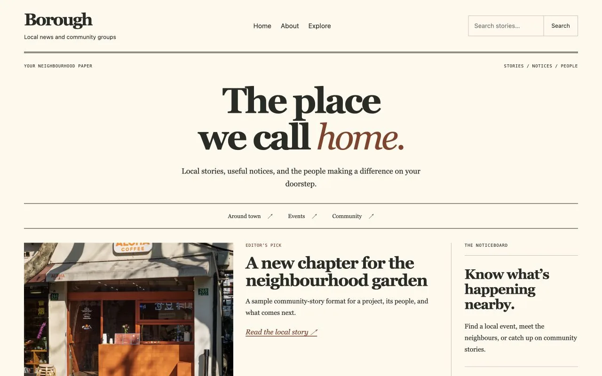</a> <strong>Borough</strong> Local news and community groups <a href="themes/borough/README.md#download">Details &amp; download</a> · <a href="https://puikinsh.github.io/Colorlib-Blogger-Templates/borough/">Live preview</a></td></tr>
<tr><td width="50%"><a href="themes/studio/README.md">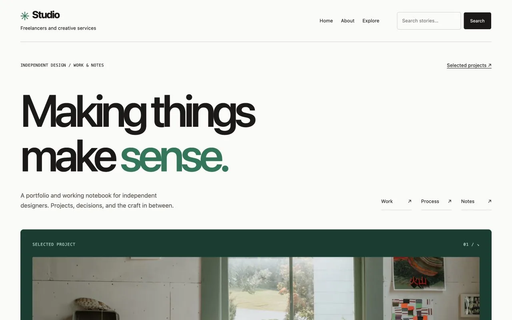</a> <strong>Studio</strong> Freelancers and creative services <a href="themes/studio/README.md#download">Details &amp; download</a> · <a href="https://puikinsh.github.io/Colorlib-Blogger-Templates/studio/">Live preview</a></td><td width="50%"><a href="themes/launchpad/README.md">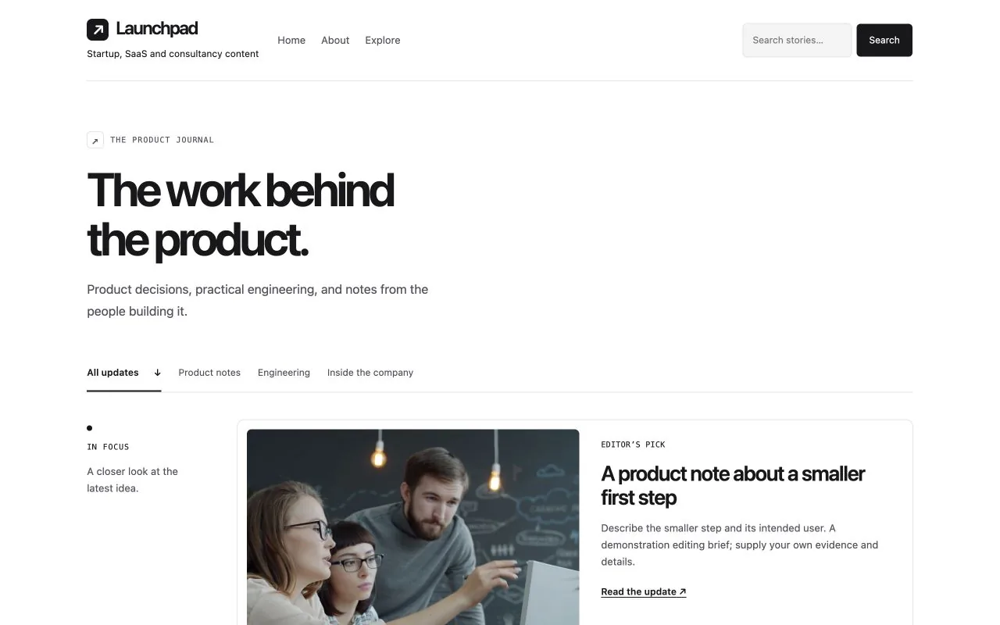</a> <strong>Launchpad</strong> Startup, SaaS and consultancy content <a href="themes/launchpad/README.md#download">Details &amp; download</a> · <a href="https://puikinsh.github.io/Colorlib-Blogger-Templates/launchpad/">Live preview</a></td></tr>
<tr><td width="50%"><a href="themes/ceremony/README.md">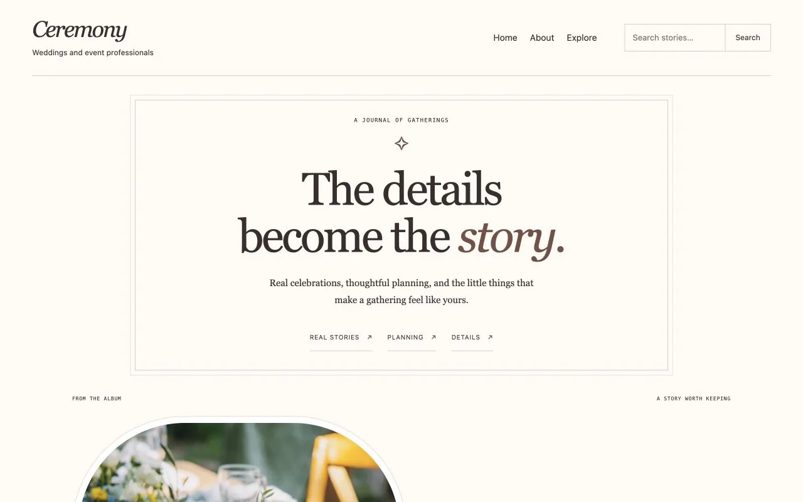</a> <strong>Ceremony</strong> Weddings and event professionals <a href="themes/ceremony/README.md#download">Details &amp; download</a> · <a href="https://puikinsh.github.io/Colorlib-Blogger-Templates/ceremony/">Live preview</a></td><td width="50%"><a href="themes/cause/README.md">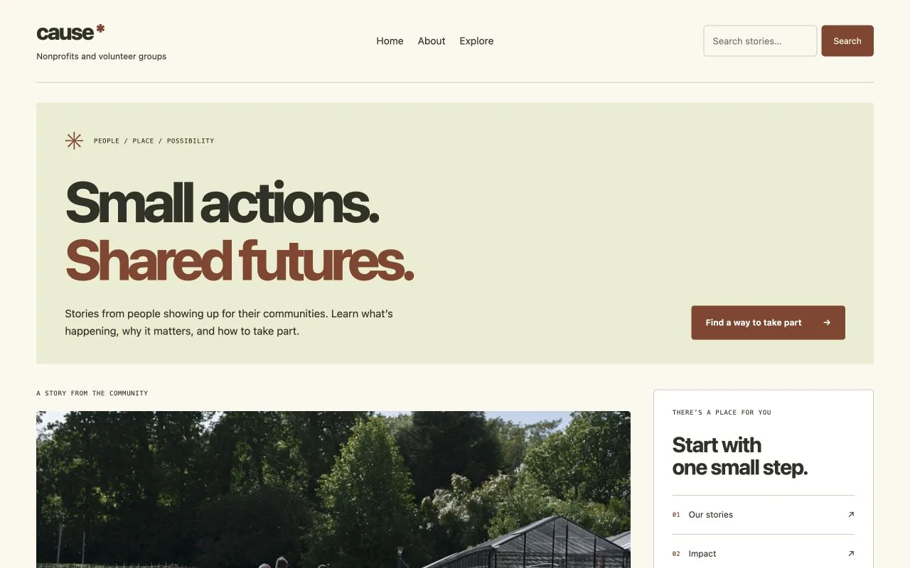</a> <strong>Cause</strong> Nonprofits and volunteer groups <a href="themes/cause/README.md#download">Details &amp; download</a> · <a href="https://puikinsh.github.io/Colorlib-Blogger-Templates/cause/">Live preview</a></td></tr>
</tbody>
</table>

## Install a template

1. Choose a design above and open its **Details & download** guide.
2. On the linked GitHub release, expand **Assets** and download the exact ZIP named in that guide. For Wayfarer, choose **`wayfarer-blogger-template-0.1.0-preview.5.zip`**.
3. Extract the ZIP. In Blogger, back up your current theme, then open **Theme → menu beside Customize → Restore → Upload**.
4. Upload the **theme XML**: for Wayfarer, **`Wayfarer-Blogger-Template.xml`** inside **`Wayfarer-Blogger-Template/`**.
5. Sample posts are optional. Import **`Wayfarer Demo Content.xml`** separately through **Settings → Manage Blog → Import content**.

| What you downloaded | What to do with it |
| --- | --- |
| `<slug>-blogger-template-0.1.0-preview.5.zip` | Extract it first. This is the packaged template. |
| `<Name>-Blogger-Template.xml` | Upload through **Theme → Restore**. |
| `<Name> Demo Content.xml` | Optional sample posts, imported through **Settings**. |
| `post-template.html` | Optional article layout for the post HTML editor. |

GitHub's **Code → Download ZIP** and **Source code (zip)** downloads are for developers. Use the named template package from **Releases** to install a Blogger theme.

## Published preview

Current packages: **0.1.0-preview.5**. [Release notes and all twenty packages](https://github.com/puikinsh/Colorlib-Blogger-Templates/releases/tag/v0.1.0-preview.5) · [Checksums](https://github.com/puikinsh/Colorlib-Blogger-Templates/releases/download/v0.1.0-preview.5/SHA256SUMS).

These packages are development previews. [Testing status](docs/RELEASE-READINESS.md) records the current validation results. Published assets are versioned and remain unchanged.

## Documentation and licensing

- [Customize your theme](docs/OWNER-EDITING.md): header, menus, colors, homepage widgets and article formats.
- [Developer setup and project status](docs/DEVELOPMENT.md): builds, source layout, regression checks and validation history.
- [Design directions](docs/DESIGN-DIRECTIONS.md): the layouts and publishing use cases behind the collection.
- [GPL v3 license](LICENSE) for the theme code and original vector artwork; [photography credits](assets/photography.json) record separate photo licenses.

The screenshots link to the actual design previews. Full desktop and mobile captures are available in each theme's guide.
