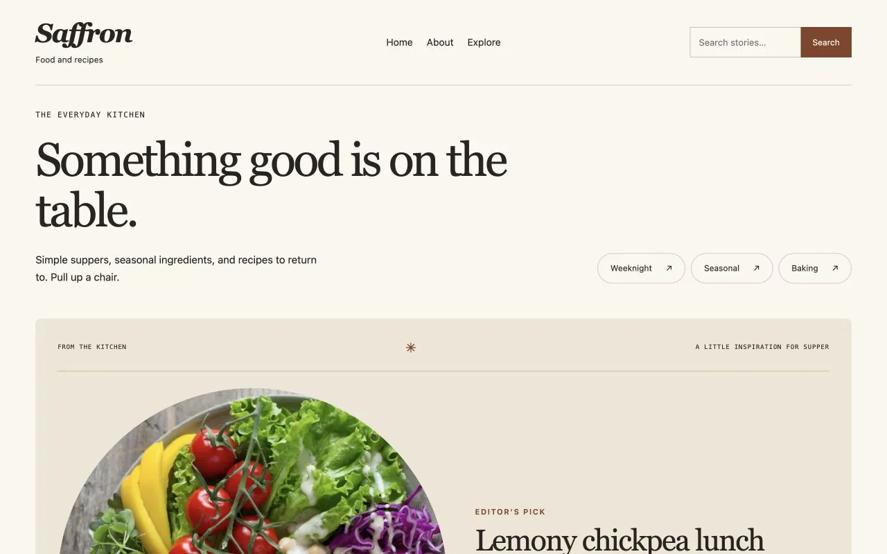

# Saffron Blogger Template

Simple suppers, seasonal ingredients, and recipes to return to. Pull up a chair.

**Best for:** Food and recipes. **Design:** Kitchen recipe index.

[Live preview](https://puikinsh.github.io/Colorlib-Blogger-Templates/saffron/) · [Full desktop screenshot](../../assets/previews/saffron-desktop.webp) · [Mobile screenshot](../../assets/previews/saffron-mobile.webp)

## Download

**Choose this exact package:** `saffron-blogger-template-0.1.0-preview.5.zip`

[Open the GitHub release downloads](https://github.com/puikinsh/Colorlib-Blogger-Templates/releases/tag/v0.1.0-preview.5) and expand **Assets** if needed. Select **`saffron-blogger-template-0.1.0-preview.5.zip`** from the list.

Use the named template package. GitHub's **Source code (zip)** and **Code → Download ZIP** contain the development repository, rather than the installable theme package.

## Which files do I need?

After extracting the package, open **`Saffron-Blogger-Template/`**.

| File | Use |
| --- | --- |
| **`Saffron-Blogger-Template.xml`** | **Install this file in Blogger → Theme → Restore → Upload.** |
| `Saffron Demo Content.xml` | Optional sample posts: Blogger → Settings → Manage Blog → Import content. |
| `post-template.html` | Optional starting layout to copy into a post's HTML editor. |
| `README.md` | Package setup and customization instructions. |
| `ASSETS.md` | Artwork and photography credits and license information. |

Do not upload the ZIP or the demo-content XML as your theme.

## Installation

1. Back up your current theme from **Blogger → Theme → menu beside Customize → Backup**.
2. Extract **`saffron-blogger-template-0.1.0-preview.5.zip`** on your computer.
3. In **Theme → menu beside Customize → Restore → Upload**, select **`Saffron-Blogger-Template.xml`** inside **`Saffron-Blogger-Template/`**.
4. If you want sample posts, use **Settings → Manage Blog → Import content** and choose **`Saffron Demo Content.xml`**. Importing sample posts is optional.
5. In **Layout**, edit your header, pages, homepage introduction and visual notebook. Adjust colors through **Theme → Customize → Advanced**.

## What you can publish

Recipe cards with ingredients, method, checklists and a print action.

The theme also includes responsive article layouts, photo galleries, native Older/Newer navigation, Blogger comments, search and editable homepage widgets. Replace sample text and use images you have permission to publish.

## Documentation

[Customization guide](../../docs/OWNER-EDITING.md) · [Release notes](https://github.com/puikinsh/Colorlib-Blogger-Templates/releases/tag/v0.1.0-preview.5) · [Testing status](../../docs/RELEASE-READINESS.md) · [License](../../LICENSE)

Current package: **0.1.0-preview.5**, a development preview. Photography retains its separate credited licenses.

[← Browse all twenty templates](../../README.md#choose-your-template)
